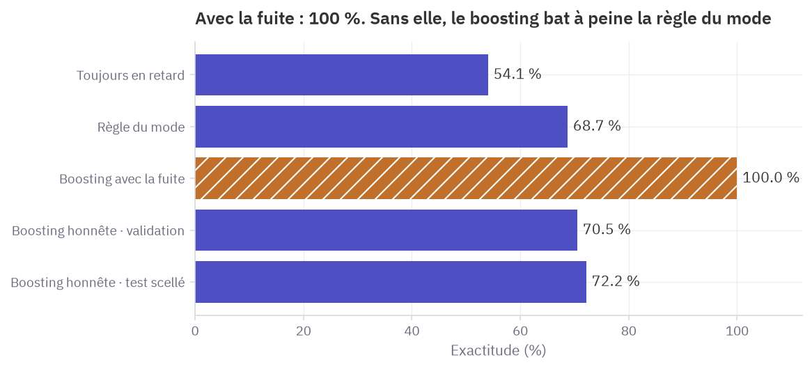
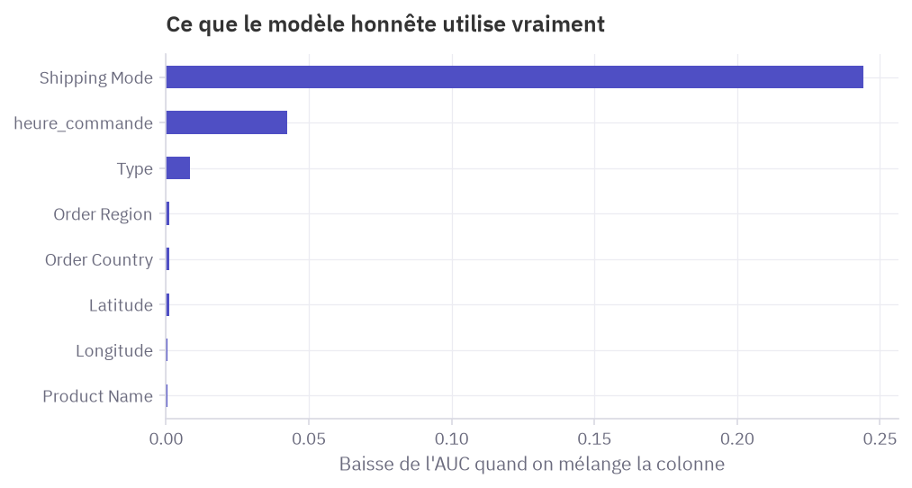
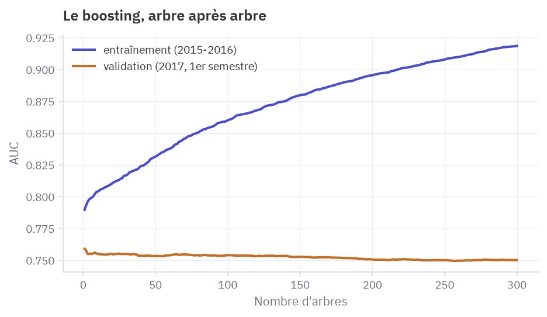

# P1 · Boosting, validation et fuites

Au moment où un client passe sa commande, peut-on prédire si sa livraison arrivera en retard, sans utiliser d'information connue seulement après coup ?

Le but est de réduire l'erreur de prédiction **honnêtement** : un modèle qui semble parfait parce qu'il voit la réponse (une fuite de données) ne sert à rien en production.

**État :** terminé.

## Compétences mobilisées

| Compétence | Ce qui est fait dans ce projet |
|---|---|
| Préparation des données | Chargement d'un CSV encodé en latin-1, retrait des données personnelles, variables tirées de la date de commande |
| Apprentissage supervisé | Classification binaire par boosting de gradient (`HistGradientBoostingClassifier`), variables catégorielles natives |
| Bases de référence | Comparaison à deux règles simples : « toujours en retard » et une règle métier sur le mode d'expédition |
| Validation dans le temps | Entraînement sur le passé, validation sur la période suivante, test scellé ouvert une seule fois |
| Détection de fuites de données | Repérage et retrait des colonnes connues seulement après la livraison |
| Évaluation | Exactitude et AUC ROC ; importance des variables par permutation ; courbe d'apprentissage arbre par arbre |
| Visualisation | Trois figures de synthèse, charte graphique commune aux projets |
| Reproductibilité | Source citée, licence respectée, commande de téléchargement et empreinte SHA-256 du fichier |

**Mots clés :** gradient boosting, data leakage, temporal validation, baseline, ROC AUC, permutation importance, overfitting, supply chain.

**Outils :** Python 3.14, pandas, scikit-learn, matplotlib, Jupyter (VS Code), git.

## Données
- **Source :** Constante, F., Silva, F. et Pereira, A. (2019). *DataCo Smart Supply Chain for Big Data Analysis*. Mendeley Data, V5. 180 519 lignes de commande, de janvier 2015 à janvier 2018.
- **DOI :** https://doi.org/10.17632/8gx2fvg2k6.5
- **Licence :** [CC BY 4.0](https://creativecommons.org/licenses/by/4.0/deed.fr) : utilisation libre, y compris commerciale, à condition de citer les auteurs et d'indiquer les modifications apportées. Seule modification : le retrait des colonnes d'identité des clients.
- **Les données ne sont pas dans ce dépôt.** Pour les obtenir (PowerShell, depuis la racine du dépôt) :
  ```
  curl.exe -L -o projets/P1-boosting-validation/donnees/DataCoSupplyChainDataset.csv "https://data.mendeley.com/public-files/datasets/8gx2fvg2k6/files/72784be5-36d3-44fe-b75d-0edbf1999f65/file_downloaded"
  ```
  Puis vérifier avec `Get-FileHash` : l'empreinte SHA-256 attendue est `FA6D022ED437155E1A2F0378710602848703C8A7F203F7FF5D77805BF8480AA6`.

## Méthode
1. Récupérer les données et vérifier leur intégrité.
2. Les explorer : cible, répartition, période couverte.
3. Retirer les données personnelles.
4. Découper dans le temps : entraînement (2015-2016), validation (1er semestre 2017), test scellé (juillet 2017 à janvier 2018).
5. Établir deux bases de référence à battre.
6. Entraîner un boosting avec toutes les colonnes, puis traquer les fuites.
7. Réentraîner un modèle honnête et le comparer aux bases.
8. Ouvrir le test une seule fois et rapporter le résultat.

## Résultats

| Modèle | Morceau | Exactitude | AUC |
|---|---|---|---|
| Toujours « en retard » | validation | 54,1 % | — |
| Règle du mode d'expédition | validation | 68,7 % | — |
| Boosting, toutes les colonnes (fuite) | validation | 100 % | 1,000 |
| Boosting honnête | validation | 70,5 % | 0,755 |
| Boosting honnête | test scellé | 72,2 % | 0,774 |



- Trois colonnes connues seulement après la livraison (`Delivery Status`, `Days for shipping (real)`, `Order Status`) donnaient un score parfait : elles ont été retirées.
- Sans fuite, le boosting ne bat la règle du mode que de 1,8 point : le mode d'expédition porte presque tout le signal.



Le mode d'expédition domine de loin ; l'heure de la commande arrive deuxième.



Sur la validation, l'AUC atteint 0,76 dès le premier arbre puis redescend doucement jusqu'à 0,75 au 300e : les arbres suivants n'ajoutent pas d'information utile.

Tableau complet : [`resultats/scores.csv`](resultats/scores.csv). Carnet : [`P1_boosting_validation.ipynb`](P1_boosting_validation.ipynb).

---
Texte de ce README rédigé avec l'assistant IA, à partir de la méthode et des résultats du projet ; le code et les résultats sont ceux de l'auteur.
