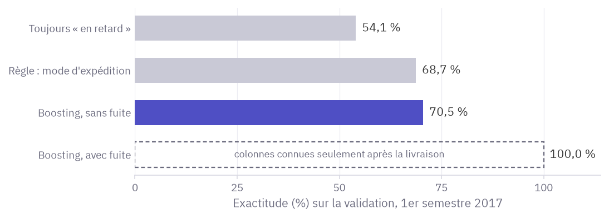
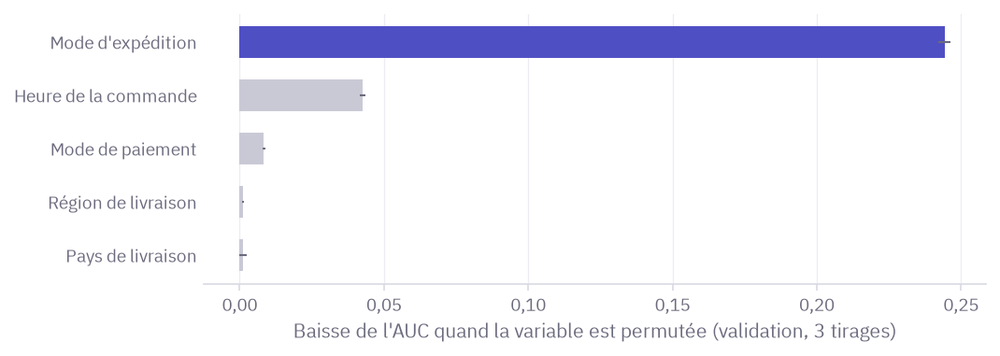
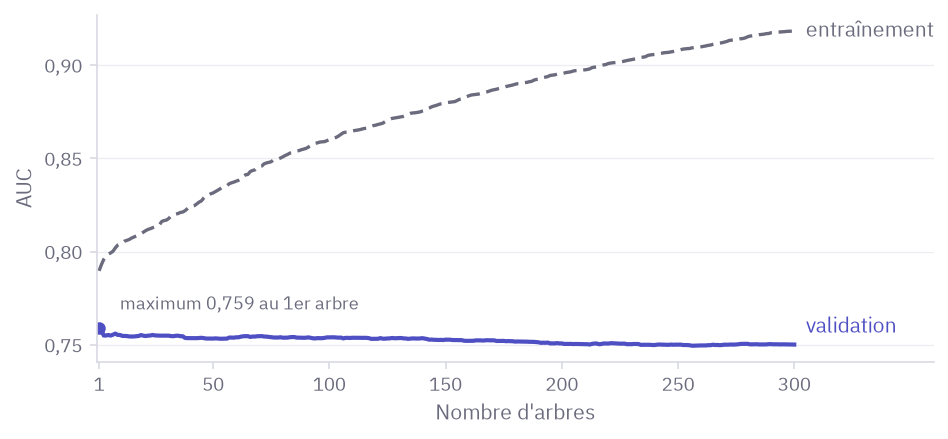

# P1 · Boosting de gradient, validation temporelle et fuite de données

Prédire, au moment où la commande est passée, si une livraison arrivera en retard. Classification binaire sur 180 519 lignes de commande (DataCo Smart Supply Chain, 2015 à 2018).

## En bref

- **Fuite détectée.** Trois variables connues seulement après la livraison donnaient une exactitude de 100 % ; elles ont été retirées.
- **Résultat sur le test** (juillet 2017 à janvier 2018, évalué une seule fois) : **72,2 % d'exactitude, AUC de 0,774**.
- **Une règle métier fait presque aussi bien.** Classer d'après le seul mode d'expédition donne 68,7 % sur la validation, contre 70,5 % pour le boosting : cette variable porte l'essentiel du signal.

<picture>
  <source media="(prefers-color-scheme: dark)" srcset="resultats/scores_validation_sombre.png">
  
</picture>

## Résultats

| Modèle | Jeu | Exactitude | AUC |
|---|---|---:|---:|
| Toujours « en retard » (classe majoritaire) | validation | 54,1 % | — |
| Règle : mode d'expédition | validation | 68,7 % | — |
| Boosting, avec fuite | validation | 100 % | 1,000 |
| Boosting, sans fuite | validation | 70,5 % | 0,755 |
| **Boosting, sans fuite** | **test** | **72,2 %** | **0,774** |

Validation : 1er semestre 2017 (30 950 lignes). Test : juillet 2017 à janvier 2018 (24 369 lignes). Détail : [`resultats/scores.csv`](resultats/scores.csv).

<picture>
  <source media="(prefers-color-scheme: dark)" srcset="resultats/importance_variables_sombre.png">
  
</picture>

Le mode d'expédition explique l'essentiel de la performance ; l'heure de la commande arrive deuxième, loin derrière.

<picture>
  <source media="(prefers-color-scheme: dark)" srcset="resultats/courbe_apprentissage_sombre.png">
  
</picture>

Sur la validation, l'AUC atteint son maximum (0,759) dès le premier arbre puis décroît lentement, alors qu'elle passe de 0,79 à 0,92 sur l'entraînement : au-delà des premiers arbres, le modèle surapprend.

## Méthode

1. **Intégrité des données** : téléchargement par commande et contrôle de l'empreinte SHA-256.
2. **Confidentialité** : retrait des colonnes d'identité (prénom, nom, adresse, courriel, mot de passe) avant toute analyse.
3. **Découpage temporel** : entraînement 2015-2016, validation au 1er semestre 2017, test de juillet 2017 à janvier 2018, ouvert une seule fois.
4. **Bases de référence** : classe majoritaire et règle métier sur le mode d'expédition.
5. **Modèle** : `HistGradientBoostingClassifier` (scikit-learn), variables catégorielles natives ; les variables de plus de 255 modalités sont encodées en entiers.
6. **Détection de fuite** : chaque variable passe le test « est-elle connue au moment de la commande ? ». Retirées : `Delivery Status`, `Days for shipping (real)`, `Order Status`.
7. **Interprétation** : importance par permutation sur l'AUC, courbe d'apprentissage selon le nombre d'arbres.

## Compétences démontrées

| Compétence | Mise en œuvre |
|---|---|
| Préparation des données | Encodage latin-1, retrait des données personnelles, variables temporelles (mois, jour, heure) |
| Apprentissage supervisé | Boosting de gradient sur données tabulaires mixtes |
| Validation | Découpage temporel, test évalué une seule fois, comparaison à des bases simples |
| Fuite de données | Détection et retrait de variables postérieures à la prédiction |
| Évaluation et interprétation | Exactitude, AUC ROC, importance par permutation, diagnostic de surapprentissage |
| Reproductibilité | Versions figées, téléchargement scripté, empreinte des données |

**Mots clés :** gradient boosting, temporal validation, data leakage, baseline, ROC AUC, permutation importance, overfitting, supply chain.

## Reproduire

Depuis la racine du dépôt (PowerShell) :

```powershell
python -m venv .venv
.venv\Scripts\activate
pip install -r projets/P1-boosting-validation/requirements.txt
curl.exe -L -o projets/P1-boosting-validation/donnees/DataCoSupplyChainDataset.csv "https://data.mendeley.com/public-files/datasets/8gx2fvg2k6/files/72784be5-36d3-44fe-b75d-0edbf1999f65/file_downloaded"
Get-FileHash projets/P1-boosting-validation/donnees/DataCoSupplyChainDataset.csv
```

L'empreinte SHA-256 attendue est `FA6D022ED437155E1A2F0378710602848703C8A7F203F7FF5D77805BF8480AA6`. Exécuter ensuite toutes les cellules de [`P1_boosting_validation.ipynb`](P1_boosting_validation.ipynb) : environ une minute sur un portable sans GPU. Les figures utilisent la charte commune du dépôt ([`style/`](../../style/)).

```
P1-boosting-validation/
├── P1_boosting_validation.ipynb   le carnet, de la donnée brute aux figures
├── requirements.txt               versions exactes
├── donnees/                       non versionné (voir ci-dessus)
└── resultats/                     scores.csv et figures (versions claire et sombre)
```

## Données et licence

Constante, F., Silva, F. et Pereira, A. (2019). *DataCo Smart Supply Chain for Big Data Analysis*. Mendeley Data, V5. https://doi.org/10.17632/8gx2fvg2k6.5 — licence [CC BY 4.0](https://creativecommons.org/licenses/by/4.0/deed.fr). Seule modification : le retrait des colonnes d'identité des clients.

---
Rédaction de ce README assistée par IA ; code, analyses et résultats de l'auteur.
