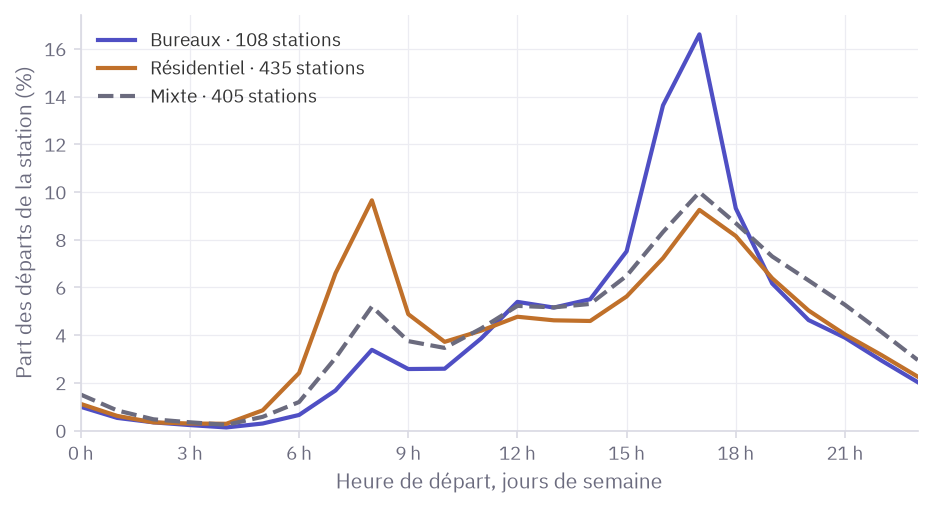
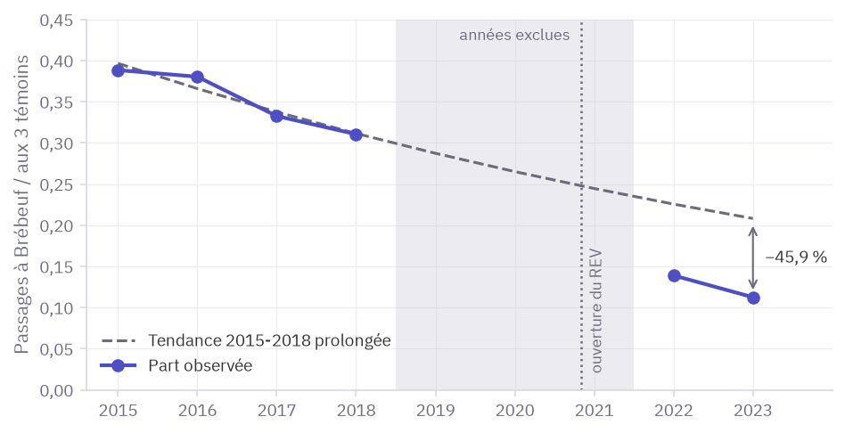

# P2 · Clustering et différence de différences

Deux questions sur le vélo à Montréal, deux familles de méthodes. D'abord, regrouper 948 stations BIXI selon l'heure à laquelle elles se vident (apprentissage non supervisé, 14,2 millions de trajets de 2025). Ensuite, mesurer l'effet du Réseau express vélo (REV) de la rue Saint-Denis, ouvert en novembre 2020, sur la piste cyclable parallèle de la rue Brébeuf (inférence causale, compteurs de la Ville de Montréal, 2015 à 2023).

## En bref

- **Trois profils de stations.** « Bureaux » (108 stations, 40 % des départs entre 16 h et 19 h), « résidentiel » (435 stations, pic à 8 h) et « mixte » (405 stations). La silhouette reste faible (0,21) : les profils forment un continuum plus que des groupes tranchés.
- **Effet estimé du REV sur la piste Brébeuf : de −38 % à −64 % de passages.** La différence de différences contre trois compteurs témoins donne −64 %, et ce résultat bouge peu selon les témoins (−61 % à −67 %).
- **Une tendance antérieure, prise en compte.** Un test placebo montre que Brébeuf déclinait déjà avant le REV (−16,5 % sur une période sans intervention). Une fois cette tendance prolongée, l'écart attribuable au REV reste de −38 % à −46 %.

## Résultats

### A · Profils horaires des stations BIXI

<picture>
  <source media="(prefers-color-scheme: dark)" srcset="resultats/profils_stations_sombre.png">
  
</picture>

| Profil | Stations | Pic | Départs de 7 h à 10 h | Départs de 16 h à 19 h | Dont Ville-Marie |
|---|---:|---:|---:|---:|---:|
| Résidentiel | 435 | 8 h | 21,1 % | 24,6 % | 52 |
| Mixte | 405 | 17 h | 12,0 % | 27,0 % | 88 |
| Bureaux | 108 | 17 h | 7,6 % | 39,6 % | 62 |

Une station de bureaux se vide en fin de journée : on y arrive le matin, on en repart le soir. Une station résidentielle se vide le matin. Le premier axe de l'ACP (40,4 % de la variance) oppose exactement ces deux moments, les départs de 7 h et 8 h à ceux de 16 h et 17 h ; le second axe en explique 17,8 %.

- **Choix de k** : de k = 2 à 8, aucun coude net d'inertie ; silhouette de 0,26 (k = 2), 0,21 (k = 3), puis 0,15 et moins. k = 3 est retenu parce que chaque groupe a une interprétation claire. Détail : [`resultats/choix_k.csv`](resultats/choix_k.csv).
- **Normalisation** : sur les comptes bruts plutôt que sur les parts horaires, les K-moyennes séparent les stations par volume (médianes de 4 560, 14 887 et 29 166 départs), et non par forme de journée.

### B · Effet du REV Saint-Denis sur la piste Brébeuf

<picture>
  <source media="(prefers-color-scheme: dark)" srcset="resultats/part_brebeuf_sombre.png">
  
</picture>

| Compteur | Passages par jour, 2015-2018 | Passages par jour, 2022-2023 | Variation |
|---|---:|---:|---:|
| **Brébeuf** (piste traitée) | 4 152 | 1 555 | **−62,5 %** |
| Parc (témoin) | 2 718 | 2 760 | +1,5 % |
| Rachel / Papineau (témoin, axe est-ouest) | 4 644 | 4 478 | −3,6 % |
| Berri1 (témoin) | 4 458 | 5 065 | +13,6 % |

Moyennes de mai à octobre, sur les jours où les quatre compteurs ont compté.

| Estimation | Effet sur Brébeuf |
|---|---:|
| Différence de différences, 3 témoins | −64,0 % |
| Même calcul avec 1 ou 2 témoins | −61,2 % à −67,0 % |
| Placebo : faux REV en 2017 (attendu : 0) | −16,5 % |
| Écart à la tendance 2015-2018 prolongée, 2022 | −38,4 % |
| Écart à la tendance 2015-2018 prolongée, 2023 | −45,9 % |

L'hypothèse, formulée avant d'ouvrir les comptages, se vérifie dans les deux sens. Brébeuf, parallèle au REV, perd la majorité de ses cyclistes, alors que Rachel / Papineau, sur un axe est-ouest, ne bouge presque pas. Détail : [`resultats/effet_rev.csv`](resultats/effet_rev.csv) et [`resultats/passages_avant_apres.csv`](resultats/passages_avant_apres.csv).

**Limites.** Le compteur de Brébeuf est en panne en 2019 et incomplet en 2021 : un changement d'appareil entre les deux périodes ne peut pas être exclu. Une seule piste traitée et trois témoins ne permettent pas d'intervalle de confiance formel ; la fourchette vient des contrôles de robustesse. Berri1 progresse de 13,6 %, peut-être en partie grâce au REV ; comme témoin, il gonfle légèrement l'effet estimé.

## Méthode

**A · Clustering** ([`P2a_profils_bixi.ipynb`](P2a_profils_bixi.ipynb))
1. Lecture du ZIP sans décompression (317 Mo, CSV de 2,8 Go), 3 colonnes sur 10.
2. Horodatages UTC convertis à l'heure de Montréal, heure d'été comprise.
3. Profil de station : part des départs de semaine par heure (24 valeurs qui somment à 1). Seuil de 1 000 départs en semaine sur l'année : 948 stations sur 1 296.
4. K-moyennes pour k = 2 à 8 (`n_init=10`, graine fixée), comparées par l'inertie et la silhouette.
5. ACP à deux composantes et lecture des poids de chaque heure.

**B · Différence de différences** ([`P2b_rev_brebeuf.ipynb`](P2b_rev_brebeuf.ipynb))
1. Hypothèse, piste traitée, témoins et facteur de confusion (2020 : pandémie et ouverture du REV) écrits avant d'ouvrir les données.
2. Harmonisation de deux formats : quotidien large de 2015 à 2018 (compteurs nommés), quart d'heure long depuis 2019 (identifiants), reliés par le fichier des sites.
3. Couverture des capteurs vérifiée avant tout calcul. Brébeuf étant en panne en 2019 et incomplet en 2021, les périodes comparées deviennent 2015-2018 et 2022-2023.
4. Témoins : compteurs à environ 1 km du REV et complets sur les deux périodes. Rachel / Hôtel-de-Ville, à 0,29 km, est écarté.
5. Moyennes quotidiennes de mai à octobre, sur les jours communs ; effet calculé en log, puis exprimé en %.
6. Robustesse : tendances parallèles, placebo, sensibilité aux témoins, tendance antérieure prolongée.

## Compétences démontrées

| Compétence | Mise en œuvre |
|---|---|
| Apprentissage non supervisé | K-moyennes sur profils normalisés, choix de k (inertie, silhouette), ACP |
| Inférence causale | Différence de différences, choix des témoins, tendances parallèles, test placebo |
| Préparation des données | 14,2 millions de lignes lues depuis une archive, fuseaux horaires, harmonisation de deux formats de comptage |
| Qualité des données | Couverture des capteurs contrôlée avant l'analyse, panne détectée, comparaison sur jours communs |
| Analyse de sensibilité | Résultat donné en fourchette, à partir de trois contrôles indépendants |
| Reproductibilité | Versions figées, téléchargement par commande, graines fixées |

**Mots clés :** clustering, k-means, silhouette score, PCA, difference-in-differences, parallel trends, placebo test, causal inference, bike sharing, urban mobility.

## Reproduire

Depuis la racine du dépôt (PowerShell) :

```powershell
python -m venv .venv
.venv\Scripts\activate
pip install -r projets/P2-clustering-did/requirements.txt

# Trajets BIXI 2025 (317 178 725 octets)
curl.exe -L --create-dirs -o projets/P2-clustering-did/donnees/bixi2025.zip "https://cdn.bixi.com/wp-content/uploads/2026/02/DonneesOuvertes2025_010203040506070809101112.zip"

# Compteurs cyclistes de la Ville de Montréal, 2015 à 2023, et fichier des sites
$base = "https://donnees.montreal.ca/dataset/142ff2e9-7d0a-47d6-b4f6-dfeb97041daf/resource"
$fichiers = @{
  "sites.csv"         = "866218c3-dac9-4d8f-bad9-eb04f257206d/download/localisations_globale.csv"
  "comptage_2015.csv" = "094e146d-f594-435a-bf4e-2cd25e510f33/download/comptagevelo20152.csv"
  "comptage_2016.csv" = "4a174080-3714-49c9-a4a5-a09cc8c718ff/download/comptagevelo20162.csv"
  "comptage_2017.csv" = "c46d286e-f9c1-424b-abfe-d9b49a6db11e/download/comptagevelo2017.csv"
  "comptage_2018.csv" = "c4079991-84d6-4644-8703-0320ee02305b/download/comptage_velo_2018.csv"
  "comptage_2019.csv" = "6c5e4fad-4bb7-4355-af6f-c8442b5c1ad3/download/comptage_velo_2019.csv"
  "comptage_2020.csv" = "08fa3b22-ffd3-4dcd-8c46-143750ceff2a/download/comptage_velo_2020.csv"
  "comptage_2021.csv" = "66175c7c-0164-4477-91c4-aa1593273ee1/download/comptage_velo_2021.csv"
  "comptage_2022.csv" = "678161ad-b9ce-4b9d-8fa6-115cf1257dbb/download/comptage_velo_2022.csv"
  "comptage_2023.csv" = "7215a1e9-a532-44ac-903f-f505ffc2b48b/download/comptage_velo_2023.csv"
}
foreach ($nom in $fichiers.Keys) {
  # le serveur refuse les requêtes sans en-tête de navigateur
  curl.exe -s -L -A "Mozilla/5.0" -o "projets/P2-clustering-did/donnees/$nom" "$base/$($fichiers[$nom])"
}
```

Exécuter ensuite toutes les cellules de [`P2a_profils_bixi.ipynb`](P2a_profils_bixi.ipynb) (environ une minute et demie sur un portable sans GPU) et de [`P2b_rev_brebeuf.ipynb`](P2b_rev_brebeuf.ipynb) (quelques secondes). Les figures utilisent la charte commune du dépôt ([`style/`](../../style/)).

```
P2-clustering-did/
├── P2a_profils_bixi.ipynb   clustering des stations BIXI
├── P2b_rev_brebeuf.ipynb    différence de différences sur les compteurs
├── requirements.txt         versions exactes
├── donnees/                 non versionné (voir ci-dessus)
└── resultats/               tableaux CSV et figures (versions claire et sombre)
```

## Données et licence

- BIXI Montréal, *Historique des déplacements*, année 2025, [bixi.com/fr/donnees-ouvertes](https://bixi.com/fr/donnees-ouvertes/) — licence [CC BY 4.0](https://creativecommons.org/licenses/by/4.0/deed.fr) ([fiche Données Québec](https://www.donneesquebec.ca/recherche/dataset/vmtl-bixi-historique-des-deplacements)), attribution « BIXI Montréal », usage non commercial. Seuls des agrégats sont publiés ici : les profils moyens des trois groupes.
- Ville de Montréal, *Compteurs cyclistes permanents*, 2015 à 2023, [Données Québec](https://www.donneesquebec.ca/recherche/dataset/vmtl-cyclistes) — licence [CC BY 4.0](https://creativecommons.org/licenses/by/4.0/deed.fr). Comptages agrégés par jour.

---
Code écrit pas à pas avec l'assistant IA ; hypothèses, choix de méthode et interprétation de l'auteur. Rédaction de ce README et figures : l'assistant IA.
