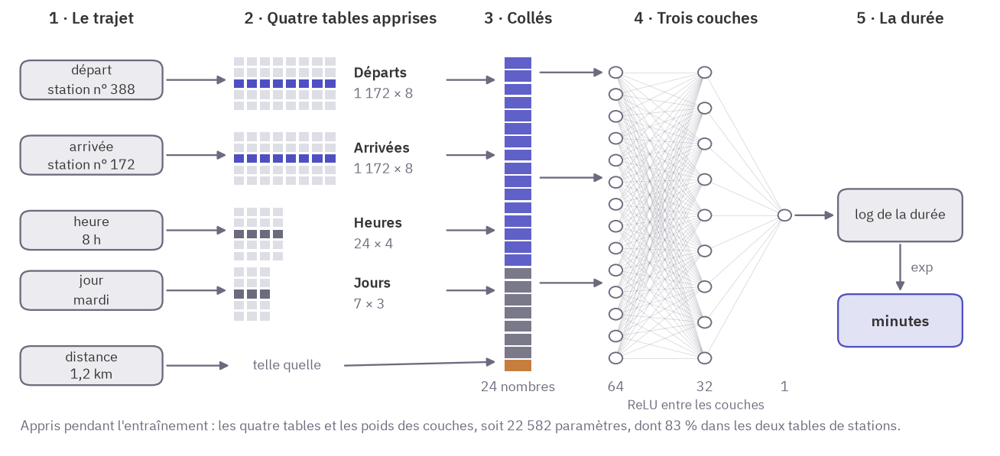
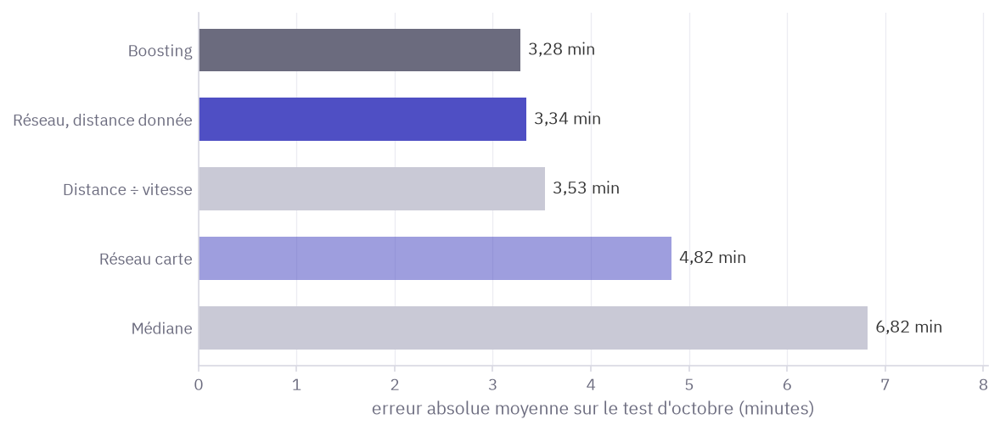
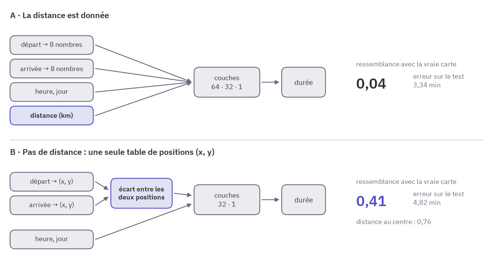
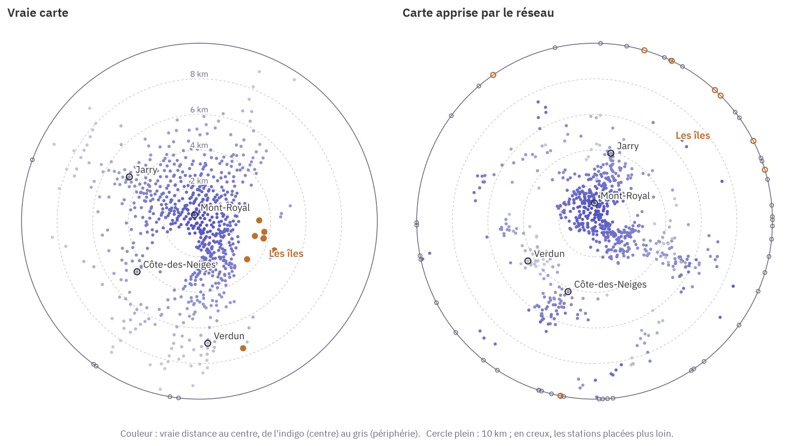
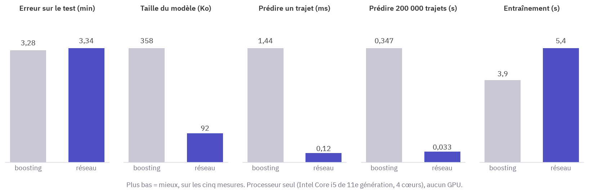
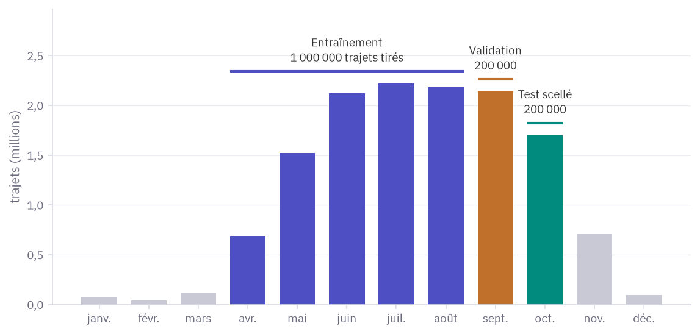
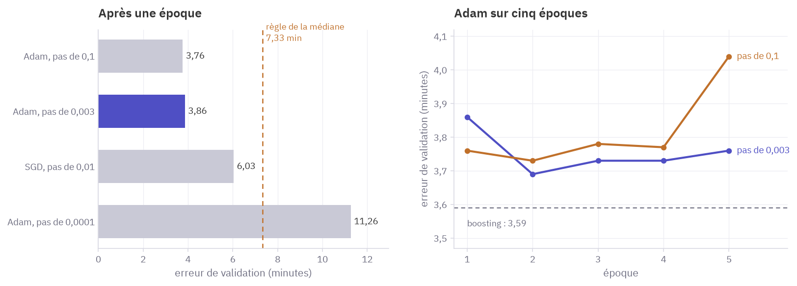

# P3 · Réseau PyTorch et plongements

Un réseau de neurones qui apprend la durée d'un trajet BIXI redessine-t-il la carte de Montréal dans ses plongements de stations ? Le projet entraîne un réseau PyTorch à tables de plongements sur un million de trajets de 2025, le compare à des règles simples et à un boosting de gradient, puis examine ce que les plongements ont appris. Tout s'entraîne et tourne sur un portable, au processeur, sans GPU ni service en ligne.

## En bref

- **Le boosting reste le plus précis : 3,28 min d'erreur absolue moyenne sur le test d'octobre**, contre 3,34 min pour le réseau et 3,53 min pour la règle « distance ÷ vitesse médiane ». Sur des données en tableau, avec une variable qui porte presque tout (la distance), les arbres gardent l'avantage.
- **Le réseau est 4 fois plus léger (92 Ko contre 358 Ko) et environ 10 fois plus rapide** pour prédire, au prix de 0,06 min d'erreur en plus. Le choix entre les deux dépend de la cible.
- **Quand la distance est donnée, les plongements ne retrouvent pas la carte** (corrélation de rang de 0,04 avec les vraies distances entre stations) : le réseau n'en a pas besoin.
- **Retirer la distance force le réseau à dessiner sa propre carte** (0,41), surtout l'opposition entre centre et périphérie (0,76). C'est l'architecture qui décide de ce que les plongements apprennent.

## Comment le réseau voit un trajet

<picture>
  <source media="(prefers-color-scheme: dark)" srcset="resultats/schema_reseau_sombre.png">
  
</picture>

Une station n'est pour le réseau qu'un numéro, l'adresse d'une ligne dans une table. Les 8 nombres de cette ligne, le **plongement** de la station, sont des paramètres appris comme les poids des couches. Une station absente de l'entraînement reçoit le numéro 0 (1,1 % des départs de septembre).

## Résultats

### Précision sur le test

<picture>
  <source media="(prefers-color-scheme: dark)" srcset="resultats/erreurs_modeles_sombre.png">
  
</picture>

| Modèle | Validation (septembre) | Test (octobre) |
|---|---:|---:|
| Médiane de l'entraînement (10,80 min) | 7,33 | 6,82 |
| Distance ÷ vitesse médiane (9,5 km/h) | 3,90 | 3,53 |
| **Boosting de gradient** | **3,59** | **3,28** |
| Réseau avec plongements, distance donnée | 3,69 | 3,34 |
| Réseau carte, sans la distance | 4,93 | 4,82 |

Erreur absolue moyenne en minutes, sur 200 000 trajets par mois. Les cinq modèles ont été figés sur la validation avant l'ouverture du test. Les erreurs baissent en octobre parce que les trajets y sont plus courts (médiane de 9,62 min, contre 10,80 à l'entraînement). Détail : [`resultats/erreurs_validation_test.csv`](resultats/erreurs_validation_test.csv).

Le réseau ne gagne que 0,19 min sur la règle de la distance, et le boosting 0,25 min : la distance à vol d'oiseau explique déjà l'essentiel de la durée. Ce résultat rejoint une comparaison sur 45 jeux de données en tableau, où les modèles à base d'arbres l'emportent le plus souvent sur les réseaux de neurones ([Grinsztajn et al., 2022](https://arxiv.org/abs/2207.08815)).

### Ce que les plongements apprennent

<picture>
  <source media="(prefers-color-scheme: dark)" srcset="resultats/deux_architectures_sombre.png">
  
</picture>

Pour 726 stations d'au moins 300 départs, environ 20 000 paires sont tirées au hasard. Pour chaque paire, on compare la distance réelle entre les deux stations et la distance entre leurs plongements, par la corrélation de Spearman (0 : aucun lien ; 1 : même ordre).

- **A · Distance donnée : 0,04.** Le réseau reçoit déjà la distance ; il n'a aucun besoin de savoir où sont les stations. Ses plongements codent autre chose que la géographie.
- **B · Pas de distance : 0,41.** Une seule table de 2 nombres par station, partagée par le départ et l'arrivée, et le réseau ne voit que l'écart entre les deux positions. Pour que tous les écarts collent aux durées, il doit placer les stations sur une carte qu'il invente. Il y perd en précision (4,82 min), mais il dessine une carte.

<picture>
  <source media="(prefers-color-scheme: dark)" srcset="resultats/carte_apprise_sombre.png">
  
</picture>

La carte apprise, centrée, mise à la même échelle et tournée au mieux (rotation orthogonale de Procrustes sur les 90 % de stations les plus centrales), garde surtout **la distance au centre** : corrélation de rang de 0,76 entre la vraie distance au centre et la distance apprise. Les directions sont bien moins conservées. Les stations des îles (parc Jean-Drapeau, Cité du Havre, île des Sœurs), à 3 ou 4 km du centre à vol d'oiseau, sont rejetées tout au bord : pour le réseau, elles sont loin, ce qui est cohérent avec des trajets plus longs par les ponts. Détail : [`resultats/cartes_apprises.csv`](resultats/cartes_apprises.csv).

### En local

<picture>
  <source media="(prefers-color-scheme: dark)" srcset="resultats/compromis_local_sombre.png">
  
</picture>

| Mesure | Boosting | Réseau |
|---|---:|---:|
| Entraînement sur 1 million de trajets | 3,9 s | 5,4 s (2 époques) |
| Prédire 200 000 trajets d'un coup | 0,347 s | 0,033 s |
| Prédire un seul trajet | 1,44 ms | 0,12 ms |
| Taille du modèle enregistré | 358 Ko | 92 Ko |

Portable sans GPU, processeur Intel Core i5 de 11e génération (4 cœurs), PyTorch sur 4 fils. Temps médian de 5 appels (50 pour un seul trajet). Les temps varient d'une exécution à l'autre selon la charge de la machine ; l'écart d'un ordre de grandeur pour la prédiction reste. Le réseau pèse 22 582 paramètres en `float32`, soit 88 Ko, plus l'en-tête du fichier. Détail : [`resultats/mesures_locales.csv`](resultats/mesures_locales.csv).

### Limites

- **Distance à vol d'oiseau.** Elle sous-estime le vrai chemin par les rues, d'où une vitesse médiane apparente de 9,5 km/h. Une distance routière, calculée en local avec [OSRM](https://project-osrm.org/) sur la carte OpenStreetMap du Québec, est la piste la plus directe pour améliorer tous les modèles.
- **Stations inconnues.** Aucun trajet d'entraînement n'a le numéro 0 : la ligne « station inconnue » garde ses valeurs initiales tirées au hasard. Elle touche 1,1 % des trajets de septembre.
- **Un seul tirage.** Une seule graine, un seul échantillon : l'écart de 0,06 min entre le boosting et le réseau est trop petit pour être affirmé sans répéter l'expérience sur plusieurs graines.
- **Le réseau carte** n'atteint pas la précision des autres modèles ; il sert à lire ce que les plongements peuvent apprendre, pas à prédire.

## Méthode

Tout est dans le carnet [`P3_duree_trajets.ipynb`](P3_duree_trajets.ipynb).

**1 · Données et nettoyage.** Lecture du ZIP BIXI 2025 sans décompression, 8 colonnes sur 10 (stations, coordonnées, heures de départ et d'arrivée). Durée = arrivée − départ.

| Étape | Trajets |
|---|---:|
| Trajets lus | 14 249 363 |
| Arrivée connue, durée de 1 à 120 min, départ ≠ arrivée | 13 621 800 |
| Sans la station de test « Test ECO5.1.1 », placée aux coordonnées (0, 0) | 13 621 790 |
| Sans le réseau de Sherbrooke (27 stations, à environ 130 km) | 13 605 052 |

Les seuils de durée sont des choix explicites : sous 1 min, on ne relie pas deux stations ; au-delà de 2 h, c'est un vélo non rendu ou une longue pause (le maximum brut dépassait 250 jours). Les boucles (retour à la station de départ) sont retirées, car leur durée ne dépend pas de la distance. La station de test et Sherbrooke ont été repérées par une distance maximale de 8 738 km, puis par une carte des stations.

**2 · Découpage dans le temps.**

<picture>
  <source media="(prefers-color-scheme: dark)" srcset="resultats/trajets_par_mois_sombre.png">
  
</picture>

Le modèle sert à prédire des trajets futurs : il apprend sur le passé et se juge sur la suite. Un échantillon d'un million de trajets d'avril à août sert à l'entraînement, 200 000 trajets de septembre à la validation (choix des modèles et des réglages), 200 000 trajets d'octobre au test, ouvert une seule fois à la fin (graine 0). Le mois n'est pas une variable : l'entraînement n'a jamais vu septembre ni octobre.

**3 · Bases simples.** La médiane de l'entraînement, puis la distance divisée par la vitesse médiane. Toutes les constantes viennent de l'entraînement.

**4 · Boosting.** `HistGradientBoostingRegressor` (réglages par défaut) sur la distance, les coordonnées du départ et de l'arrivée, l'heure et le jour. Les 1 171 stations dépassent la limite de 255 catégories du modèle : elles entrent par leurs coordonnées. La cible est le logarithme de la durée, pour qu'une erreur pèse en proportion de la durée du trajet.

**5 · Réseau PyTorch.** Plongements de 8 nombres pour les stations de départ et d'arrivée, de 4 pour l'heure, de 3 pour le jour, plus la distance ; couches de 64 et 32 neurones (ReLU), une sortie : le logarithme de la durée. Perte quadratique moyenne sur ce logarithme, Adam, lots de 1 000 trajets. L'erreur de validation est au plus bas à la 2e époque, puis remonte : le réseau retenu s'arrête là (arrêt précoce).

<picture>
  <source media="(prefers-color-scheme: dark)" srcset="resultats/pas_apprentissage_sombre.png">
  
</picture>

Le pas d'apprentissage décide de tout : à 0,0001, le réseau a à peine quitté son point de départ au bout d'une époque et fait pire que la médiane ; à 0,1, il avance vite puis oscille. Le pas de 0,003 donne une courbe régulière. Détail : [`resultats/erreurs_par_epoque.csv`](resultats/erreurs_par_epoque.csv).

**6 · Lecture des plongements.** Corrélation de Spearman entre distances réelles et distances entre plongements, puis réseau « carte » (une table de positions à 2 nombres, l'écart entre positions à la place de la distance ; Adam au pas de 0,01, 12 époques), aligné sur la vraie carte par une rotation orthogonale.

**7 · Mesure en local, puis test.** Temps et taille au processeur, puis une seule évaluation des cinq modèles figés sur octobre.

## Compétences démontrées

| Compétence | Mise en œuvre |
|---|---|
| PyTorch | `nn.Module`, tables de plongements (`nn.Embedding`), boucle d'entraînement par lots, Adam et SGD, arrêt précoce |
| Plongements de variables catégorielles | 1 171 stations, heure et jour en plongements ; indice réservé aux stations inconnues |
| Validation sans fuite | Découpage dans le temps, réglages choisis sur la validation, test scellé ouvert une fois |
| Comparaison de modèles | Deux bases simples, boosting de gradient, deux architectures de réseau |
| Qualité des données | Seuils explicites, station de test aux coordonnées (0, 0) et réseau de Sherbrooke repérés et retirés |
| Interprétation | Corrélation de rang, rotation orthogonale de Procrustes, lecture de la carte apprise |
| Exécution locale | Temps d'entraînement et de prédiction, taille des modèles, au processeur seulement |

**Mots clés :** PyTorch, entity embeddings, neural network, gradient boosting, temporal validation, early stopping, learning rate, Spearman correlation, Procrustes, CPU inference, on-premise, travel time prediction, bike sharing.

## Reproduire

Depuis la racine du dépôt (PowerShell) :

```powershell
python -m venv .venv
.venv\Scripts\activate
pip install -r projets/P3-pytorch-plongements/requirements.txt

# Trajets BIXI 2025 (317 178 725 octets)
curl.exe -L --create-dirs -o projets/P3-pytorch-plongements/donnees/bixi2025.zip "https://cdn.bixi.com/wp-content/uploads/2026/02/DonneesOuvertes2025_010203040506070809101112.zip"

# Figures du README, à partir des CSV de resultats/
python projets/P3-pytorch-plongements/figures.py
```

Exécuter toutes les cellules de [`P3_duree_trajets.ipynb`](P3_duree_trajets.ipynb) depuis son dossier : environ trois minutes et demie sur un portable sans GPU. Le carnet produit la carte apprise et le tableau des erreurs ; [`figures.py`](figures.py) produit les autres figures à partir des petits CSV de [`resultats/`](resultats/), qui reprennent les sorties du carnet. Les figures utilisent la charte commune du dépôt ([`style/`](../../style/)).

```
P3-pytorch-plongements/
├── P3_duree_trajets.ipynb   données, bases, boosting, réseaux, carte apprise, mesures, test
├── figures.py               figures du README
├── requirements.txt         versions exactes
├── donnees/                 non versionné : trajets BIXI et modèles enregistrés
└── resultats/               tableaux CSV et figures (versions claire et sombre)
```

## Analyse rétroactive

*Texte de l'auteur, corrigé par l'assistant IA.*

- **Compris :** le boosting est une méthode intéressante, avec des qualités différentes de celles d'un réseau de neurones mais un usage semblable, chacun ayant ses points positifs et négatifs. J'ai aussi compris la projection, ou plongement : partir d'une variable, avec comme entrée une liste de variables, la convertir en tenseur, puis découper les données en lots, sur plusieurs époques, jusqu'à atteindre un minimum local, ou global.
- **Surpris :** que les arbres de décision du boosting prennent autant de temps, comparés à un réseau qui est rapide, tout en étant très bons pour les données, du moins quand elles sont tabulaires.
- **Ensuite :** incorporer des données géographiques, peut-être des images satellites, pour voir les résultats du réseau de neurones.

## Pour aller plus loin

- C. Guo et F. Berkhahn, *Entity Embeddings of Categorical Variables*, 2016, [arXiv:1604.06737](https://arxiv.org/abs/1604.06737) : les plongements appliqués aux variables catégorielles de données en tableau.
- L. Grinsztajn, E. Oyallon et G. Varoquaux, *Why do tree-based models still outperform deep learning on tabular data?*, 2022, [arXiv:2207.08815](https://arxiv.org/abs/2207.08815).

## Données et licence

- BIXI Montréal, *Historique des déplacements*, année 2025, [bixi.com/fr/donnees-ouvertes](https://bixi.com/fr/donnees-ouvertes/) — licence [CC BY 4.0](https://creativecommons.org/licenses/by/4.0/deed.fr) ([fiche Données Québec](https://www.donneesquebec.ca/recherche/dataset/vmtl-bixi-historique-des-deplacements)), attribution « BIXI Montréal », usage non commercial. Seuls des agrégats sont publiés ici : comptes mensuels, erreurs des modèles et positions de stations publiques.

---
Code écrit pas à pas avec l'assistant IA ; choix de méthode et interprétation de l'auteur. Boucle d'entraînement, code des figures et rédaction de ce README : l'assistant IA.
